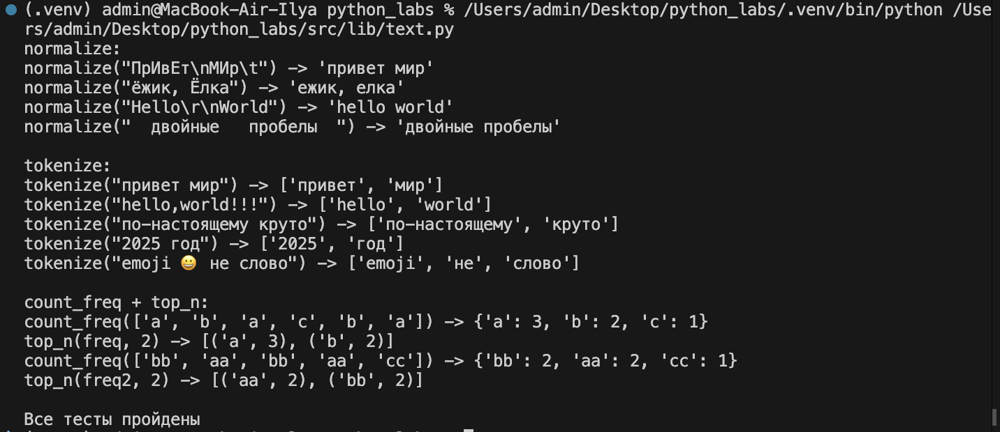
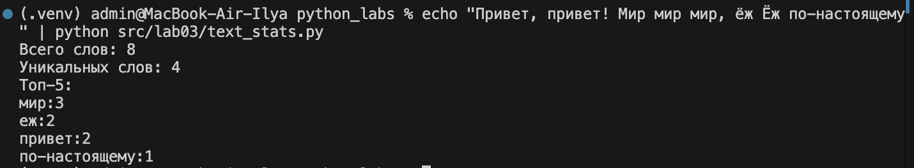
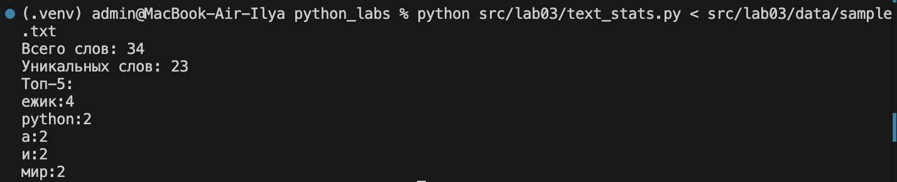

# Лабораторная работа №3

## Задание A. src/lib/text.py

```python
import re

WORD_RE = re.compile(r'\w+(?:-\w+)*')


def normalize(text: str, *, casefold: bool = True, yo2e: bool = True) -> str:
    """Функция нормализует строку

    Аргументы:
        text: исходная строка
        casefold: True - привести к casefold, False - к lower
        yo2e: True - заменить все ё/Ё на е/Е

    Вывод:
        Нормализованная строка: пробелы, табуляции и переносы строк схлопнуты в один пробел, края обрезаны

    Ошибки:
        TypeError: если text не строка
    """

    if not isinstance(text, str):
        raise TypeError('text должен быть строкой')

    text = text.casefold() if casefold else text.lower()

    if yo2e:
        text = text.replace('ё', 'е').replace('Ё', 'Е')

    return ' '.join(text.split())


def tokenize(text: str) -> list[str]:
    """Функция разбивает текст на слова

    Слово - последовательность символов \\w (буквы/цифры/подчёркивание), внутри слова допускается дефис (например, "по-настоящему"). Числа считаются словами, эмодзи и знаки препинания - разделители.

    Аргумент:
        text: строка (предполагается, что уже нормализована)

    Вывод:
        Список слов в порядке появления в тексте

    Ошибки:
        TypeError: если text не строка
    """

    if not isinstance(text, str):
        raise TypeError('text должен быть строкой')

    return WORD_RE.findall(text)


def count_freq(tokens: list[str]) -> dict[str, int]:
    """Функция считает частоты слов

    Аргумент:
        tokens: список токенов

    Вывод:
        Словарь слово -> количество вхождений
    """

    freq: dict[str, int] = {}
    for token in tokens:
        freq[token] = freq.get(token, 0) + 1
    return freq


def top_n(freq: dict[str, int], n: int = 5) -> list[tuple[str, int]]:
    """Функция возвращает топ-N слов по частоте

    Аргументы:
        freq: словарь слово -> частота
        n: сколько слов вернуть (по умолчанию 5)

    Вывод:
        Список пар (слово, частота), отсортированный по убыванию частоты,
        при равенстве частот - по алфавиту слова

    Ошибки:
        ValueError: если n отрицательное
    """

    if n < 0:
        raise ValueError('n не может быть отрицательным')

    items = sorted(freq.items(), key=lambda pair: (-pair[1], pair[0]))
    return items[:n]


def check(call: str, got: object, expected: object) -> None:
    """Функция выводит результат вызова и проверяет его через assert

    Аргументы:
        call: текст вызова для вывода
        got: полученный результат
        expected: ожидаемый результат
    """

    print(f'{call} -> {got!r}')
    assert got == expected, f'ожидалось {expected!r}'


if __name__ == '__main__':
    print('normalize:')
    check('normalize("ПрИвЕт\\nМИр\\t")', normalize("ПрИвЕт\nМИр\t"), "привет мир")
    check('normalize("ёжик, Ёлка")', normalize("ёжик, Ёлка"), "ежик, елка")
    check('normalize("Hello\\r\\nWorld")', normalize("Hello\r\nWorld"), "hello world")
    check('normalize("  двойные   пробелы  ")',
          normalize("  двойные   пробелы  "), "двойные пробелы")

    print('\ntokenize:')
    check('tokenize("привет мир")', tokenize("привет мир"), ["привет", "мир"])
    check('tokenize("hello,world!!!")', tokenize("hello,world!!!"), ["hello", "world"])
    check('tokenize("по-настоящему круто")',
          tokenize("по-настоящему круто"), ["по-настоящему", "круто"])
    check('tokenize("2025 год")', tokenize("2025 год"), ["2025", "год"])
    check('tokenize("emoji 😀 не слово")',
          tokenize("emoji 😀 не слово"), ["emoji", "не", "слово"])

    print('\ncount_freq + top_n:')
    tokens = ["a", "b", "a", "c", "b", "a"]
    freq = count_freq(tokens)
    check(f'count_freq({tokens})', freq, {"a": 3, "b": 2, "c": 1})
    check('top_n(freq, 2)', top_n(freq, 2), [("a", 3), ("b", 2)])

    tokens2 = ["bb", "aa", "bb", "aa", "cc"]
    freq2 = count_freq(tokens2)
    check(f'count_freq({tokens2})', freq2, {"aa": 2, "bb": 2, "cc": 1})
    check('top_n(freq2, 2)', top_n(freq2, 2), [("aa", 2), ("bb", 2)])

    print('\nВсе тесты пройдены')
```

### Примеры

normalize:

```
"ПрИвЕт\nМИр\t" -> "привет мир"
"ёжик, Ёлка" -> "ежик, елка"
"Hello\r\nWorld" -> "hello world"
"  двойные   пробелы  " -> "двойные пробелы"
```

tokenize:

```
"привет мир" -> ["привет", "мир"]
"hello,world!!!" -> ["hello", "world"]
"по-настоящему круто" -> ["по-настоящему", "круто"]
"2025 год" -> ["2025", "год"]
"emoji 😀 не слово" -> ["emoji", "не", "слово"]
```

count_freq + top_n:

```
["a", "b", "a", "c", "b", "a"] -> {"a": 3, "b": 2, "c": 1}
top_n(..., n=2) -> [("a", 3), ("b", 2)]
["bb", "aa", "bb", "aa", "cc"] -> {"aa": 2, "bb": 2, "cc": 1}
top_n(..., n=2) -> [("aa", 2), ("bb", 2)]
```

Примеры с ошибками:

```
normalize(123) -> TypeError: text должен быть строкой
tokenize(None) -> TypeError: text должен быть строкой
top_n({"a": 1}, -1) -> ValueError: n не может быть отрицательным
```

Запуск встроенных тестов: `python src/lib/text.py`

```
normalize:
normalize("ПрИвЕт\nМИр\t") -> 'привет мир'
normalize("ёжик, Ёлка") -> 'ежик, елка'
normalize("Hello\r\nWorld") -> 'hello world'
normalize("  двойные   пробелы  ") -> 'двойные пробелы'

tokenize:
tokenize("привет мир") -> ['привет', 'мир']
tokenize("hello,world!!!") -> ['hello', 'world']
tokenize("по-настоящему круто") -> ['по-настоящему', 'круто']
tokenize("2025 год") -> ['2025', 'год']
tokenize("emoji 😀 не слово") -> ['emoji', 'не', 'слово']

count_freq + top_n:
count_freq(['a', 'b', 'a', 'c', 'b', 'a']) -> {'a': 3, 'b': 2, 'c': 1}
top_n(freq, 2) -> [('a', 3), ('b', 2)]
count_freq(['bb', 'aa', 'bb', 'aa', 'cc']) -> {'bb': 2, 'aa': 2, 'cc': 1}
top_n(freq2, 2) -> [('aa', 2), ('bb', 2)]

Все тесты пройдены
```



## Задание B. src/lab03/text_stats.py

```python
import sys
from pathlib import Path

sys.path.insert(0, str(Path(__file__).resolve().parent.parent))

from lib.text import normalize, tokenize, count_freq, top_n

TOP_COUNT = 5


def main() -> None:
    text = sys.stdin.read()
    tokens = tokenize(normalize(text))
    freq = count_freq(tokens)
    top = top_n(freq, TOP_COUNT)

    print(f'Всего слов: {len(tokens)}')
    print(f'Уникальных слов: {len(freq)}')
    print(f'Топ-{TOP_COUNT}:')
    for word, count in top:
        print(f'{word}:{count}')


if __name__ == '__main__':
    main()
```

Скрипт читает весь ввод до конца (EOF) через `sys.stdin.read()`: это может быть одна строка, многострочный текст, файл или результат другой команды через `|`.

### Пример запуска

```
$ echo "Привет, привет! Мир мир мир, ёж Ёж по-настоящему" | python src/lab03/text_stats.py
Всего слов: 8
Уникальных слов: 4
Топ-5:
мир:3
еж:2
привет:2
по-настоящему:1
```



### Пример запуска с файлом

Файл с тестовым текстом: `src/lab03/data/sample.txt`.

```
$ python src/lab03/text_stats.py < src/lab03/data/sample.txt
Всего слов: 34
Уникальных слов: 23
Топ-5:
ежик:4
python:2
а:2
и:2
мир:2
```

