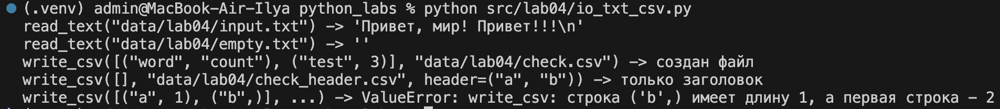
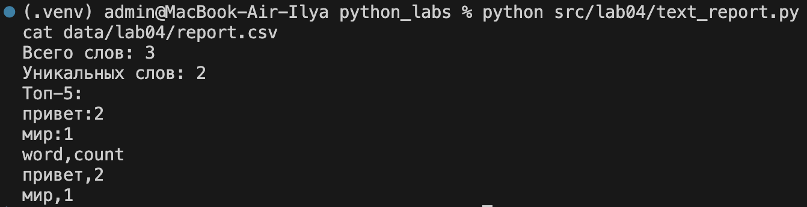
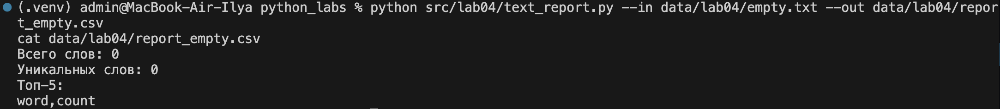
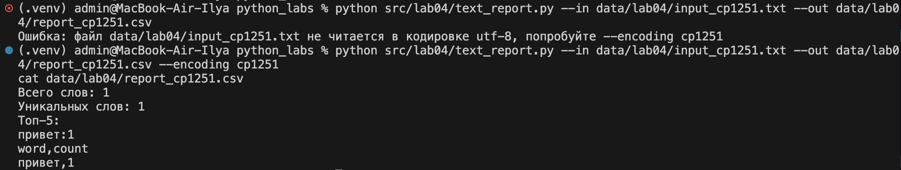
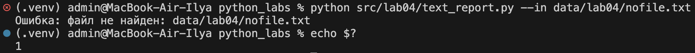

# Лабораторная работа 4

## Задание A - модуль ввода/вывода `src/lab04/io_txt_csv.py`

### 1. Функция `read_text`

Функция читает файл целиком и возвращает его содержимое в виде одной строки. По умолчанию используется кодировка UTF-8, но при необходимости можно передать другую кодировку, например `encoding='cp1251'`.

```python
import csv
from pathlib import Path


def read_text(path: str | Path, encoding: str = 'utf-8') -> str:
    """Функция читает текстовый файл целиком и возвращает его содержимое

    Аргументы:
        path: путь к файлу (строка или Path)
        encoding: кодировка файла, по умолчанию 'utf-8'.
            Если файл сохранён в другой кодировке, её можно передать явно,
            например: read_text('data/lab04/input.txt', encoding='cp1251')

    Вывод:
        Содержимое файла одной строкой (для пустого файла - пустая строка '')

    Ошибки:
        FileNotFoundError: если файла нет
        UnicodeDecodeError: если файл не читается в указанной кодировке
    """

    with open(path, 'r', encoding=encoding) as f:
        return f.read()
```

Если файл не найден, возникает `FileNotFoundError`. При несовпадении кодировки возникает `UnicodeDecodeError`. Для пустого файла функция возвращает пустую строку.

### 2. Функция `write_csv`

Функция записывает строки в CSV-файл с разделителем `,`. Перед записью проверяется, что все строки имеют одинаковую длину. Если длины отличаются, вызывается `ValueError`.

```python
def write_csv(rows: list[tuple | list], path: str | Path,
              header: tuple[str, ...] | None = None) -> None:
    """Функция создаёт (или перезаписывает) CSV-файл с разделителем ','

    Аргументы:
        rows: список строк таблицы, каждая строка - кортеж или список
        path: путь к CSV-файлу
        header: заголовок таблицы, записывается первой строкой (если передан)

    Вывод:
        Ничего не возвращает. Если rows пустой и header=None - создаётся пустой файл,
        если rows пустой и header передан - в файле будет только заголовок

    Ошибки:
        ValueError: если строки в rows разной длины
    """

    for row in rows:
        if len(row) != len(rows[0]):
            raise ValueError(f'write_csv: строка {row} имеет длину {len(row)}, '
                             f'а первая строка - {len(rows[0])}')

    with open(path, 'w', encoding='utf-8', newline='') as f:
        writer = csv.writer(f)
        if header is not None:
            writer.writerow(header)
        writer.writerows(rows)
```

Если передан параметр `header`, он записывается первой строкой файла. При пустом `rows` и `header=None` создается пустой файл, а при пустом `rows` с заголовком в файле остается только заголовок.

### 3. Проверка модуля

```python
if __name__ == '__main__':
    text = read_text('data/lab04/input.txt')
    print(f'read_text("data/lab04/input.txt") -> {text!r}')

    empty = read_text('data/lab04/empty.txt')
    print(f'read_text("data/lab04/empty.txt") -> {empty!r}')

    write_csv([('word', 'count'), ('test', 3)], 'data/lab04/check.csv')
    print('write_csv([("word", "count"), ("test", 3)], "data/lab04/check.csv") -> создан файл')

    write_csv([], 'data/lab04/check_header.csv', header=('a', 'b'))
    print('write_csv([], "data/lab04/check_header.csv", header=("a", "b")) -> только заголовок')

    try:
        write_csv([('a', 1), ('b',)], 'data/lab04/check_bad.csv')
    except ValueError as e:
        print(f'write_csv([("a", 1), ("b",)], ...) -> ValueError: {e}')
```

```bash
python src/lab04/io_txt_csv.py
```



*Рис. 1. Результат проверки функций `read_text` и `write_csv`.*

## Задание B - скрипт статистики `src/lab04/text_report.py`

Скрипт читает текстовый файл, использует функции `normalize`, `tokenize`, `count_freq` и `top_n` из лабораторной работы №3, сохраняет частоты слов в CSV-файл и выводит краткое резюме в консоль.

### Исходный код `src/lab04/text_report.py`

```python
import argparse
import sys
from pathlib import Path

sys.path.insert(0, str(Path(__file__).resolve().parent.parent))

from lib.text import normalize, tokenize, count_freq, top_n
from lab04.io_txt_csv import read_text, write_csv

TOP_COUNT = 5


def load_text(path: str, encoding: str) -> str:
    """Функция читает файл, а при ошибке сообщает о ней и завершает программу

    Аргументы:
        path: путь к файлу
        encoding: кодировка файла

    Вывод:
        Содержимое файла одной строкой
    """

    try:
        return read_text(path, encoding=encoding)
    except FileNotFoundError:
        print(f'Ошибка: файл не найден: {path}', file=sys.stderr)
        sys.exit(1)
    except UnicodeDecodeError:
        print(f'Ошибка: файл {path} не читается в кодировке {encoding}, '
              f'попробуйте --encoding cp1251', file=sys.stderr)
        sys.exit(1)


def main() -> None:
    parser = argparse.ArgumentParser(description='Отчёт по частотам слов в текстовом файле')
    parser.add_argument('--in', dest='input', default='data/lab04/input.txt',
                        help='входной файл')
    parser.add_argument('--out', default='data/lab04/report.csv',
                        help='файл отчёта')
    parser.add_argument('--encoding', default='utf-8',
                        help='кодировка входного файла')
    args = parser.parse_args()

    text = load_text(args.input, args.encoding)
    tokens = tokenize(normalize(text))
    freq = count_freq(tokens)
    rows = top_n(freq, len(freq))

    write_csv(rows, args.out, header=('word', 'count'))

    print(f'Всего слов: {len(tokens)}')
    print(f'Уникальных слов: {len(freq)}')
    print(f'Топ-{TOP_COUNT}:')
    for word, count in top_n(freq, TOP_COUNT):
        print(f'{word}:{count}')


if __name__ == '__main__':
    main()
```

Скрипт поддерживает следующие параметры:

- `--in` - входной файл, по умолчанию `data/lab04/input.txt`;
- `--out` - путь к отчету, по умолчанию `data/lab04/report.csv`;
- `--encoding` - кодировка входного файла, по умолчанию `utf-8`.

Отчет всегда записывается в UTF-8. Строки в отчете отсортированы по `count` по убыванию, при равных значениях по `word` по алфавиту.

### Пример запуска для одного файла

Входной файл `data/lab04/input.txt`:

```
Привет, мир! Привет!!!
```

```bash
python src/lab04/text_report.py
```

В этом режиме читается `data/lab04/input.txt`, а результат записывается в `data/lab04/report.csv`:

```csv
word,count
привет,2
мир,1
```



*Рис. 2. Результат запуска скрипта для входного файла по умолчанию.*

### Пустой файл

```bash
python src/lab04/text_report.py --in data/lab04/empty.txt --out data/lab04/report_empty.csv
```

Если входной файл пустой, скрипт выполняется без ошибки, а в отчете остается только заголовок:

```csv
word,count
```



*Рис. 3. Результат запуска скрипта для пустого файла.*

### Файл в кодировке cp1251

Файл `data/lab04/input_cp1251.txt` содержит слово `Привет` в кодировке cp1251. Без параметра `--encoding` скрипт сообщает, что файл не читается в UTF-8, и завершается с кодом 1. С параметром `--encoding cp1251` файл читается правильно.

```bash
python src/lab04/text_report.py --in data/lab04/input_cp1251.txt --out data/lab04/report_cp1251.csv --encoding cp1251
```

```csv
word,count
привет,1
```



*Рис. 4. Результат запуска скрипта для файла в кодировке cp1251.*

### Файл не найден

```bash
python src/lab04/text_report.py --in data/lab04/nofile.txt
```

Если входного файла нет, скрипт выводит сообщение об ошибке в stderr и завершается с кодом 1 через `sys.exit(1)`.



*Рис. 5. Результат запуска скрипта, когда входной файл не найден.*
