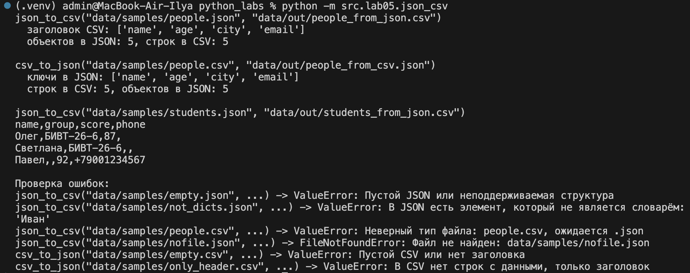
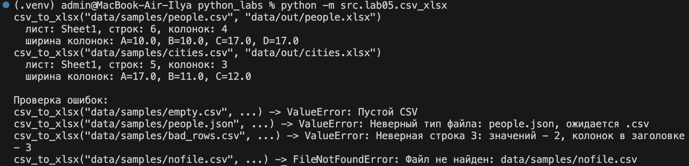
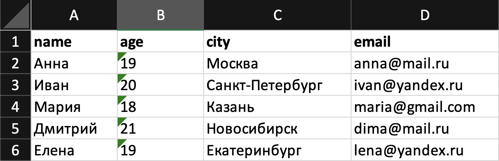
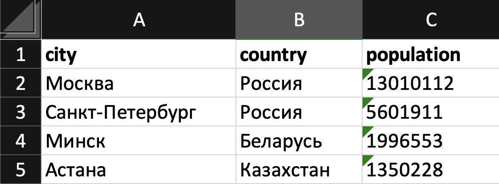

# Лабораторная работа 5

Цель: разобраться с форматом JSON, сериализацией/десериализацией и табличными конвертациями.

## Подготовка

Для конвертации в XLSX используется библиотека `openpyxl`, она указана в `requirements.txt`. Остальной код использует только стандартную библиотеку (`json`, `csv`, `pathlib`).

```bash
pip install -r requirements.txt
```

Все команды запускаются из корня репозитория `python_labs` через `python -m`. Так пути к файлам (`data/...`) считаются от корня, а импорты ищутся от корня, потому что в `sys.path[0]` попадает текущая папка. В папках `src`, `src/lib`, `src/lab04` и `src/lab05` лежат пустые `__init__.py`, они делают эти папки пакетами.

## Задание A - JSON и CSV `src/lab05/json_csv.py`

### 1. Вспомогательные функции проверки файлов

Обе функции конвертации сначала проверяют файлы. У входного файла проверяется расширение и то, что файл существует. У выходного файла проверяется расширение, а папка для него создается, если ее еще нет.

```python
import csv
import json
from pathlib import Path


def check_file(path: str | Path, suffix: str) -> Path:
    """Функция проверяет входной файл перед чтением

    Аргументы:
        path: путь к файлу
        suffix: ожидаемое расширение, например '.json' или '.csv'

    Вывод:
        Путь к файлу в виде Path

    Ошибки:
        ValueError: если у файла другое расширение
        FileNotFoundError: если файла нет
    """

    path = Path(path)
    if path.suffix.lower() != suffix:
        raise ValueError(f'Неверный тип файла: {path.name}, ожидается {suffix}')
    if not path.is_file():
        raise FileNotFoundError(f'Файл не найден: {path}')
    return path


def check_out_file(path: str | Path, suffix: str) -> Path:
    """Функция проверяет расширение выходного файла и создаёт папку для него

    Аргументы:
        path: путь к выходному файлу
        suffix: ожидаемое расширение

    Вывод:
        Путь к файлу в виде Path

    Ошибки:
        ValueError: если у файла другое расширение
    """

    path = Path(path)
    if path.suffix.lower() != suffix:
        raise ValueError(f'Неверный тип файла: {path.name}, ожидается {suffix}')
    path.parent.mkdir(parents=True, exist_ok=True)
    return path
```

### 2. Функция `json_to_csv`

Функция читает JSON-файл, который должен быть списком словарей, и записывает его в CSV через `csv.DictWriter`.

Порядок колонок - как в первом объекте. Если у объекта нет какого-то поля, в CSV на этом месте записывается пустая строка (`restval=''`). Если у объекта есть поле, которого нет в первом объекте, функция вызывает `ValueError`, чтобы данные не потерялись молча. Список или словарь внутри значения тоже вызывает `ValueError`, потому что в одну ячейку CSV они не помещаются.

```python
def json_to_csv(json_path: str, csv_path: str) -> None:
    """Функция преобразует JSON-файл в CSV

    JSON должен быть списком словарей [{...}, {...}]. Порядок колонок - как в первом
    объекте. Если у объекта нет какого-то поля, оно заполняется пустой строкой.

    Аргументы:
        json_path: путь к входному JSON-файлу
        csv_path: путь к выходному CSV-файлу

    Вывод:
        Ничего не возвращает, создаёт (или перезаписывает) CSV-файл в UTF-8

    Ошибки:
        FileNotFoundError: если JSON-файла нет
        ValueError: неверный тип файла, пустой или битый JSON, не список или в списке
            есть не словари, у объекта есть поле, которого нет в первом объекте,
            в значении лежит список или словарь (в одну ячейку CSV не влезает)
    """

    json_file = check_file(json_path, '.json')
    csv_file = check_out_file(csv_path, '.csv')

    with open(json_file, 'r', encoding='utf-8') as f:
        text = f.read()

    if text.strip() == '':
        raise ValueError('Пустой JSON или неподдерживаемая структура')

    try:
        data = json.loads(text)
    except json.JSONDecodeError as e:
        raise ValueError(f'Битый JSON в файле {json_file.name}: {e.msg}, строка {e.lineno}')

    if not isinstance(data, list) or len(data) == 0:
        raise ValueError('Пустой JSON или неподдерживаемая структура')

    for item in data:
        if not isinstance(item, dict):
            raise ValueError(f'В JSON есть элемент, который не является словарём: {item!r}')

    fieldnames = list(data[0].keys())
    if len(fieldnames) == 0:
        raise ValueError('Первый объект в JSON пустой, колонок нет')

    for i, item in enumerate(data, start=1):
        for key, value in item.items():
            if key not in fieldnames:
                raise ValueError(f'В объекте {i} есть поле "{key}", которого нет в первом объекте')
            if isinstance(value, (list, dict)):
                raise ValueError(f'В объекте {i} в поле "{key}" лежит список или словарь, '
                                 f'а в ячейку CSV помещается только одно значение')

    with open(csv_file, 'w', encoding='utf-8', newline='') as f:
        writer = csv.DictWriter(f, fieldnames=fieldnames, restval='')
        writer.writeheader()
        writer.writerows(data)
```

### 3. Функция `csv_to_json`

Функция читает CSV через `csv.DictReader`, каждая строка превращается в словарь, где ключи - названия колонок из заголовка. Все значения сохраняются как строки, потому что CSV не хранит типы данных. Запись выполняется через `json.dump(..., ensure_ascii=False, indent=2)`, поэтому русские буквы в JSON остаются читаемыми.

```python
def csv_to_json(csv_path: str, json_path: str) -> None:
    """Функция преобразует CSV в JSON (список словарей)

    Первая строка CSV - заголовок, каждая следующая строка становится словарём.
    Все значения сохраняются как строки.

    Аргументы:
        csv_path: путь к входному CSV-файлу
        json_path: путь к выходному JSON-файлу

    Вывод:
        Ничего не возвращает, создаёт (или перезаписывает) JSON-файл в UTF-8

    Ошибки:
        FileNotFoundError: если CSV-файла нет
        ValueError: неверный тип файла, пустой CSV, нет заголовка или нет строк с данными,
            в строке больше значений, чем колонок в заголовке
    """

    csv_file = check_file(csv_path, '.csv')
    json_file = check_out_file(json_path, '.json')

    with open(csv_file, 'r', encoding='utf-8', newline='') as f:
        reader = csv.DictReader(f, restval='')
        header = reader.fieldnames

        if not header:
            raise ValueError('Пустой CSV или нет заголовка')
        for name in header:
            if name.strip() == '':
                raise ValueError('В заголовке CSV есть пустое название колонки')
        if len(set(header)) != len(header):
            raise ValueError('В заголовке CSV есть повторяющиеся колонки')

        rows = []
        for row in reader:
            if None in row:
                raise ValueError(f'В строке {reader.line_num} больше значений, чем колонок')
            rows.append(row)

    if len(rows) == 0:
        raise ValueError('В CSV нет строк с данными, только заголовок')

    with open(json_file, 'w', encoding='utf-8') as f:
        json.dump(rows, f, ensure_ascii=False, indent=2)
```

### 4. Обработка ошибок

| Ситуация | Ошибка |
|---|---|
| Файла нет | `FileNotFoundError` |
| Неверное расширение файла (например, `.csv` вместо `.json`) | `ValueError` |
| Пустой файл `.json` или пустой список `[]`, или JSON не является списком | `ValueError("Пустой JSON или неподдерживаемая структура")` |
| Битый JSON (например, лишняя запятая) | `ValueError` с текстом ошибки и номером строки |
| В списке JSON есть элементы, которые не являются словарями | `ValueError` |
| В объекте есть поле, которого нет в первом объекте | `ValueError` |
| В значении лежит список или словарь | `ValueError` |
| Пустой CSV или CSV без заголовка | `ValueError` |
| В заголовке CSV пустая или повторяющаяся колонка | `ValueError` |
| В CSV только заголовок, без строк с данными | `ValueError` |
| В строке CSV больше значений, чем колонок | `ValueError` |

### 5. Проверка модуля

```python
def main() -> None:
    json_to_csv('data/samples/people.json', 'data/out/people_from_json.csv')
    with open('data/samples/people.json', encoding='utf-8') as f:
        people = json.load(f)
    with open('data/out/people_from_json.csv', encoding='utf-8', newline='') as f:
        csv_rows = list(csv.DictReader(f))
        header = list(csv_rows[0].keys())
    print('json_to_csv("data/samples/people.json", "data/out/people_from_json.csv")')
    print(f'  заголовок CSV: {header}')
    print(f'  объектов в JSON: {len(people)}, строк в CSV: {len(csv_rows)}')

    csv_to_json('data/samples/people.csv', 'data/out/people_from_csv.json')
    with open('data/samples/people.csv', encoding='utf-8', newline='') as f:
        csv_rows = list(csv.DictReader(f))
    with open('data/out/people_from_csv.json', encoding='utf-8') as f:
        people = json.load(f)
    print('\ncsv_to_json("data/samples/people.csv", "data/out/people_from_csv.json")')
    print(f'  ключи в JSON: {list(people[0].keys())}')
    print(f'  строк в CSV: {len(csv_rows)}, объектов в JSON: {len(people)}')

    json_to_csv('data/samples/students.json', 'data/out/students_from_json.csv')
    print('\njson_to_csv("data/samples/students.json", "data/out/students_from_json.csv")')
    with open('data/out/students_from_json.csv', encoding='utf-8', newline='') as f:
        print(f.read().strip())

    print('\nПроверка ошибок:')
    bad_calls = [
        ('json_to_csv', 'data/samples/empty.json'),
        ('json_to_csv', 'data/samples/broken.json'),
        ('json_to_csv', 'data/samples/not_dicts.json'),
        ('json_to_csv', 'data/samples/extra_keys.json'),
        ('json_to_csv', 'data/samples/people.csv'),
        ('json_to_csv', 'data/samples/nofile.json'),
        ('csv_to_json', 'data/samples/empty.csv'),
        ('csv_to_json', 'data/samples/only_header.csv'),
    ]
    for func_name, path in bad_calls:
        try:
            if func_name == 'json_to_csv':
                json_to_csv(path, 'data/out/bad.csv')
            else:
                csv_to_json(path, 'data/out/bad.json')
        except (ValueError, FileNotFoundError) as e:
            print(f'{func_name}("{path}", ...) -> {type(e).__name__}: {e}')


if __name__ == '__main__':
    main()
```

```bash
python -m src.lab05.json_csv
```



*Рис. 1. Результат проверки функций `json_to_csv` и `csv_to_json`.*

## Задание B - CSV в XLSX `src/lab05/csv_xlsx.py`

### Функция `csv_to_xlsx`

Функция читает CSV через `csv.reader` и переносит все строки на лист `Sheet1` через `ws.append`. Первая строка - заголовок, она выделяется жирным шрифтом.

Ширина колонки считается по самому длинному значению в этой колонке, но не меньше 8 символов. К ширине добавляется 2 символа, чтобы текст не прилипал к границе ячейки.

```python
import csv
from pathlib import Path

from openpyxl import Workbook
from openpyxl.styles import Font
from openpyxl.utils import get_column_letter

MIN_WIDTH = 8


def csv_to_xlsx(csv_path: str, xlsx_path: str) -> None:
    """Функция конвертирует CSV в XLSX

    Первая строка CSV - заголовок (выделяется жирным). Лист называется "Sheet1".
    Ширина каждой колонки подбирается по самому длинному значению, но не меньше 8 символов.

    Аргументы:
        csv_path: путь к входному CSV-файлу
        xlsx_path: путь к выходному XLSX-файлу

    Вывод:
        Ничего не возвращает, создаёт (или перезаписывает) XLSX-файл

    Ошибки:
        FileNotFoundError: если CSV-файла нет
        ValueError: неверный тип файла, пустой CSV, нет заголовка
            или строки разной длины
    """

    csv_file = Path(csv_path)
    xlsx_file = Path(xlsx_path)

    if csv_file.suffix.lower() != '.csv':
        raise ValueError(f'Неверный тип файла: {csv_file.name}, ожидается .csv')
    if xlsx_file.suffix.lower() != '.xlsx':
        raise ValueError(f'Неверный тип файла: {xlsx_file.name}, ожидается .xlsx')
    if not csv_file.is_file():
        raise FileNotFoundError(f'Файл не найден: {csv_file}')

    with open(csv_file, 'r', encoding='utf-8', newline='') as f:
        rows = list(csv.reader(f))

    if len(rows) == 0:
        raise ValueError('Пустой CSV')

    header = rows[0]
    if len(header) == 0 or '' in [name.strip() for name in header]:
        raise ValueError('В CSV нет заголовка или в нём есть пустая колонка')

    for i, row in enumerate(rows, start=1):
        if len(row) != len(header):
            raise ValueError(f'Неверная строка {i}: значений - {len(row)}, '
                             f'колонок в заголовке - {len(header)}')

    wb = Workbook()
    ws = wb.active
    ws.title = 'Sheet1'

    for row in rows:
        ws.append(row)

    for cell in ws[1]:
        cell.font = Font(bold=True)

    for col in range(len(header)):
        max_len = max(len(row[col]) for row in rows)
        width = max(max_len, MIN_WIDTH) + 2
        ws.column_dimensions[get_column_letter(col + 1)].width = width

    xlsx_file.parent.mkdir(parents=True, exist_ok=True)
    wb.save(xlsx_file)
```

Ошибки:

- файла нет - `FileNotFoundError`;
- неверное расширение входного или выходного файла - `ValueError`;
- пустой CSV или пустое название колонки в заголовке - `ValueError`;
- строки разной длины - `ValueError`.

### Проверка модуля

```python
def main() -> None:
    from openpyxl import load_workbook

    for src, dst in [('data/samples/people.csv', 'data/out/people.xlsx'),
                     ('data/samples/cities.csv', 'data/out/cities.xlsx')]:
        csv_to_xlsx(src, dst)
        ws = load_workbook(dst).active
        print(f'csv_to_xlsx("{src}", "{dst}")')
        print(f'  лист: {ws.title}, строк: {ws.max_row}, колонок: {ws.max_column}')
        widths = []
        for col in range(1, ws.max_column + 1):
            letter = get_column_letter(col)
            widths.append(f'{letter}={ws.column_dimensions[letter].width}')
        print(f'  ширина колонок: {", ".join(widths)}')

    print('\nПроверка ошибок:')
    for path in ['data/samples/empty.csv', 'data/samples/people.json',
                 'data/samples/bad_rows.csv', 'data/samples/nofile.csv']:
        try:
            csv_to_xlsx(path, 'data/out/bad.xlsx')
        except (ValueError, FileNotFoundError) as e:
            print(f'csv_to_xlsx("{path}", ...) -> {type(e).__name__}: {e}')


if __name__ == '__main__':
    main()
```

```bash
python -m src.lab05.csv_xlsx
```



*Рис. 2. Результат проверки функции `csv_to_xlsx`.*

## Сценарии демонстрации

### Сценарий 1. JSON в CSV

Входной файл `data/samples/people.json`:

```json
[
  {"name": "Анна", "age": 19, "city": "Москва", "email": "anna@mail.ru"},
  {"name": "Иван", "age": 20, "city": "Санкт-Петербург", "email": "ivan@yandex.ru"},
  {"name": "Мария", "age": 18, "city": "Казань", "email": "maria@gmail.com"},
  {"name": "Дмитрий", "age": 21, "city": "Новосибирск", "email": "dima@mail.ru"},
  {"name": "Елена", "age": 19, "city": "Екатеринбург", "email": "lena@yandex.ru"}
]
```

Результат `data/out/people_from_json.csv`:

```csv
name,age,city,email
Анна,19,Москва,anna@mail.ru
Иван,20,Санкт-Петербург,ivan@yandex.ru
Мария,18,Казань,maria@gmail.com
Дмитрий,21,Новосибирск,dima@mail.ru
Елена,19,Екатеринбург,lena@yandex.ru
```

Заголовок CSV совпадает с ключами объектов: `name,age,city,email`. В JSON 5 объектов, в CSV 5 строк с данными (без заголовка).

### Сценарий 2. JSON с пропущенными полями

Собственный пример `data/samples/students.json`, где у некоторых объектов нет части полей:

```json
[
  {"name": "Олег", "group": "БИВТ-26-6", "score": 87},
  {"name": "Светлана", "group": "БИВТ-26-6"},
  {"name": "Павел", "score": 92}
]
```

Результат `data/out/students_from_json.csv`:

```csv
name,group,score
Олег,БИВТ-26-6,87
Светлана,БИВТ-26-6,
Павел,,92
```

Колонки взяты из первого объекта. У Светланы нет поля `score`, а у Павла нет поля `group`, поэтому в этих ячейках пустые строки.

### Сценарий 3. CSV в JSON

Входной файл `data/samples/people.csv`:

```csv
name,age,city,email
Анна,19,Москва,anna@mail.ru
Иван,20,Санкт-Петербург,ivan@yandex.ru
Мария,18,Казань,maria@gmail.com
Дмитрий,21,Новосибирск,dima@mail.ru
Елена,19,Екатеринбург,lena@yandex.ru
```

Результат `data/out/people_from_csv.json` (первые два объекта):

```json
[
  {
    "name": "Анна",
    "age": "19",
    "city": "Москва",
    "email": "anna@mail.ru"
  },
  {
    "name": "Иван",
    "age": "20",
    "city": "Санкт-Петербург",
    "email": "ivan@yandex.ru"
  },
  ...
]
```

Ключи в JSON совпадают с заголовком CSV, количество объектов (5) совпадает с количеством строк в CSV. Возраст записан строкой `"19"`, а не числом, так как значения из CSV сохраняются как строки.

### Сценарий 4. CSV в XLSX

```bash
python -m src.lab05.csv_xlsx
```

Из `data/samples/people.csv` получается `data/out/people.xlsx`, из `data/samples/cities.csv` - `data/out/cities.xlsx`. Файлы открываются в Excel, лист называется `Sheet1`, ширина колонок подобрана по длине текста.



*Рис. 3. Файл `data/out/people.xlsx`, открытый в Excel.*



*Рис. 4. Файл `data/out/cities.xlsx`, открытый в Excel.*

### Файлы для проверки ошибок

| Файл | Что проверяет |
|---|---|
| `data/samples/empty.json` | пустой список `[]` |
| `data/samples/broken.json` | битый JSON, лишняя запятая в конце списка |
| `data/samples/not_dicts.json` | в списке есть строка и число вместо словарей |
| `data/samples/extra_keys.json` | у второго объекта есть поле, которого нет в первом |
| `data/samples/empty.csv` | полностью пустой CSV |
| `data/samples/only_header.csv` | CSV только с заголовком |
| `data/samples/bad_rows.csv` | строка с меньшим количеством значений |

## Допущения

- Кодировка всех файлов - UTF-8.
- Разделитель в CSV - запятая.
- JSON должен быть списком плоских словарей, вложенные списки и словари не поддерживаются.
- Порядок колонок при конвертации JSON в CSV - как в первом объекте.
- При конвертации CSV в JSON все значения остаются строками, типы не приводятся.
- В XLSX все значения записываются как текст, так как в CSV типов нет.
