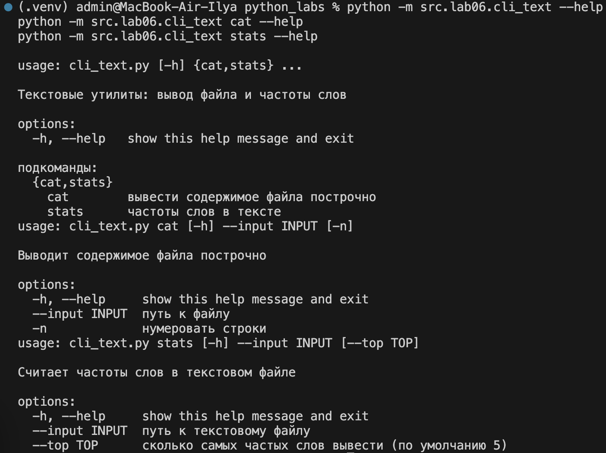
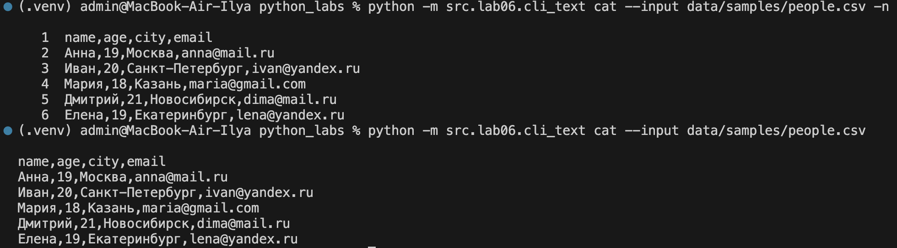
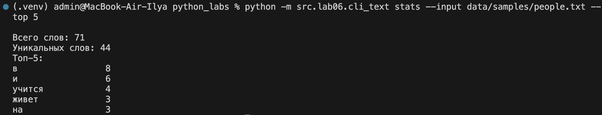
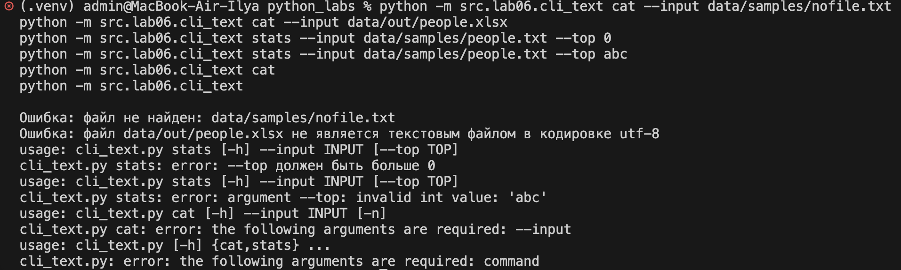
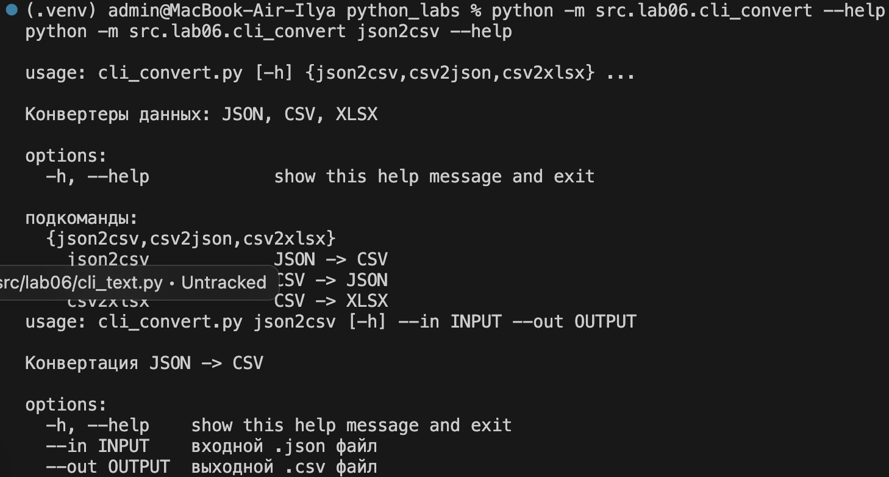
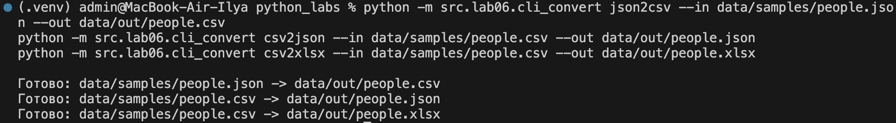
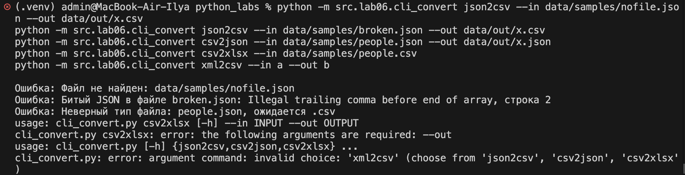

# Лабораторная работа 6

```bash
pip install -r requirements.txt
```

## Задание A - текстовые утилиты `src/lab06/cli_text.py`

Модуль содержит две подкоманды:

| Подкоманда | Параметры | Что делает |
|---|---|---|
| `cat` | `--input <path>` (обязательный), `-n` (флаг) | выводит содержимое файла построчно, с флагом `-n` - с номерами строк |
| `stats` | `--input <txt>` (обязательный), `--top N` (по умолчанию 5) | выводит количество слов, количество уникальных слов и топ-N слов по частоте |

Для подсчета слов используются функции `normalize`, `tokenize`, `count_freq` и `top_n` из лабораторной работы №3 (`src/lib/text.py`), а файл читается функцией `read_text` из лабораторной работы №4.

### Исходный код

```python
import argparse
import sys
from pathlib import Path

from src.lib.text import normalize, tokenize, count_freq, top_n
from src.lab04.io_txt_csv import read_text


def check_input(path: str) -> Path:
    """Функция проверяет, что входной файл существует

    Аргументы:
        path: путь к файлу

    Вывод:
        Путь к файлу в виде Path

    Ошибки:
        FileNotFoundError: если файла нет
        IsADirectoryError: если по пути лежит папка, а не файл
    """

    path = Path(path)
    if not path.exists():
        raise FileNotFoundError(f'файл не найден: {path}')
    if path.is_dir():
        raise IsADirectoryError(f'{path} - это папка, а не файл')
    return path


def cat(path: str, number: bool) -> None:
    """Функция выводит содержимое файла построчно

    Аргументы:
        path: путь к файлу
        number: True - перед каждой строкой выводится ее номер

    Вывод:
        Ничего не возвращает, печатает строки файла

    Ошибки:
        FileNotFoundError: если файла нет
        IsADirectoryError: если указана папка
        UnicodeDecodeError: если файл не читается в utf-8
    """

    file = check_input(path)
    with open(file, 'r', encoding='utf-8') as f:
        for i, line in enumerate(f, start=1):
            line = line.rstrip('\n')
            if number:
                print(f'{i:>4}  {line}')
            else:
                print(line)


def stats(path: str, top: int) -> None:
    """Функция выводит статистику слов в текстовом файле

    Аргументы:
        path: путь к текстовому файлу
        top: сколько самых частых слов вывести

    Вывод:
        Ничего не возвращает, печатает количество слов и топ слов по частоте

    Ошибки:
        FileNotFoundError: если файла нет
        IsADirectoryError: если указана папка
        UnicodeDecodeError: если файл не читается в utf-8
    """

    file = check_input(path)
    text = read_text(file)
    tokens = tokenize(normalize(text))
    freq = count_freq(tokens)

    print(f'Всего слов: {len(tokens)}')
    print(f'Уникальных слов: {len(freq)}')

    if len(tokens) == 0:
        print('В файле нет слов')
        return

    print(f'Топ-{top}:')
    for word, count in top_n(freq, top):
        print(f'{word:<15}{count:>4}')


def main() -> None:
    parser = argparse.ArgumentParser(description='Текстовые утилиты: вывод файла и частоты слов')
    subparsers = parser.add_subparsers(dest='command', required=True, title='подкоманды')

    cat_parser = subparsers.add_parser('cat', help='вывести содержимое файла построчно',
                                       description='Выводит содержимое файла построчно')
    cat_parser.add_argument('--input', required=True, help='путь к файлу')
    cat_parser.add_argument('-n', action='store_true', help='нумеровать строки')

    stats_parser = subparsers.add_parser('stats', help='частоты слов в тексте',
                                         description='Считает частоты слов в текстовом файле')
    stats_parser.add_argument('--input', required=True, help='путь к текстовому файлу')
    stats_parser.add_argument('--top', type=int, default=5,
                              help='сколько самых частых слов вывести (по умолчанию 5)')

    args = parser.parse_args()

    if args.command == 'stats' and args.top <= 0:
        stats_parser.error('--top должен быть больше 0')

    try:
        if args.command == 'cat':
            cat(args.input, args.n)
        elif args.command == 'stats':
            stats(args.input, args.top)
    except (FileNotFoundError, IsADirectoryError) as e:
        print(f'Ошибка: {e}', file=sys.stderr)
        sys.exit(1)
    except UnicodeDecodeError:
        print(f'Ошибка: файл {args.input} не является текстовым файлом в кодировке utf-8',
              file=sys.stderr)
        sys.exit(1)


if __name__ == '__main__':
    main()
```

### Справка

```bash
python -m src.lab06.cli_text --help
python -m src.lab06.cli_text cat --help
python -m src.lab06.cli_text stats --help
```

```
usage: cli_text.py [-h] {cat,stats} ...

Текстовые утилиты: вывод файла и частоты слов

options:
  -h, --help   show this help message and exit

подкоманды:
  {cat,stats}
    cat        вывести содержимое файла построчно
    stats      частоты слов в тексте
```



*Рис. 1. Справка по модулю `cli_text` и по подкомандам `cat` и `stats`.*

### Подкоманда `cat`

```bash
python -m src.lab06.cli_text cat --input data/samples/people.csv -n
```

```
   1  name,age,city,email
   2  Анна,19,Москва,anna@mail.ru
   3  Иван,20,Санкт-Петербург,ivan@yandex.ru
   4  Мария,18,Казань,maria@gmail.com
   5  Дмитрий,21,Новосибирск,dima@mail.ru
   6  Елена,19,Екатеринбург,lena@yandex.ru
```

Без флага `-n` строки выводятся без номеров:

```bash
python -m src.lab06.cli_text cat --input data/samples/people.csv
```



*Рис. 2. Вывод файла `people.csv` с нумерацией строк и без нее.*

### Подкоманда `stats`

Входной файл `data/samples/people.txt`:

```
Анна живет в Москве и учится в университете на первом курсе.
Иван живет в Санкт-Петербурге и тоже учится в университете.
Мария приехала из Казани, ей 18 лет, она учится на первом курсе.
Дмитрий приехал из Новосибирска, ему 21 год.
Елена живет в Екатеринбурге и учится в колледже.
Анна и Мария учатся в одной группе, а Иван и Дмитрий - в другой.
Все они любят программирование на Python и каждый день вайбкодят.
```

```bash
python -m src.lab06.cli_text stats --input data/samples/people.txt --top 5
```

```
Всего слов: 71
Уникальных слов: 44
Топ-5:
в                 8
и                 6
учится            4
живет             3
на                3
```



*Рис. 3. Топ-5 слов в файле `people.txt`.*

### Обработка ошибок

| Ситуация | Что выводится | Код возврата |
|---|---|---|
| Файла нет | `Ошибка: файл не найден: ...` | 1 |
| Вместо файла указана папка | `Ошибка: ... - это папка, а не файл` | 1 |
| Файл не текстовый (например, `.xlsx` или картинка) | `Ошибка: файл ... не является текстовым файлом в кодировке utf-8` | 1 |
| Не указана подкоманда или указана неизвестная | ошибка `argparse` и строка `usage` | 2 |
| Не указан `--input` | `error: the following arguments are required: --input` | 2 |
| `--top` не число | `error: argument --top: invalid int value` | 2 |
| `--top` меньше или равен 0 | `error: --top должен быть больше 0` (через `parser.error`) | 2 |

```bash
python -m src.lab06.cli_text cat --input data/samples/nofile.txt
python -m src.lab06.cli_text cat --input data/out/people.xlsx
python -m src.lab06.cli_text stats --input data/samples/people.txt --top 0
python -m src.lab06.cli_text stats --input data/samples/people.txt --top abc
python -m src.lab06.cli_text cat
python -m src.lab06.cli_text
```



*Рис. 4. Сообщения об ошибках модуля `cli_text`.*

## Задание B - конвертеры `src/lab06/cli_convert.py`

Модуль содержит три подкоманды, у каждой два обязательных параметра `--in` (входной файл) и `--out` (выходной файл):

| Подкоманда | Что делает | Функция из ЛР5 |
|---|---|---|
| `json2csv` | JSON -> CSV | `json_to_csv` из `src/lab05/json_csv.py` |
| `csv2json` | CSV -> JSON | `csv_to_json` из `src/lab05/json_csv.py` |
| `csv2xlsx` | CSV -> XLSX | `csv_to_xlsx` из `src/lab05/csv_xlsx.py` |

Так как `--in` - это не только имя параметра, но и слово `in` в Python, в `add_argument` указано `dest='input'`, и значение берется из `args.input`.

### Исходный код

```python
import argparse
import sys

from src.lab05.json_csv import json_to_csv, csv_to_json


def main() -> None:
    parser = argparse.ArgumentParser(description='Конвертеры данных: JSON, CSV, XLSX')
    subparsers = parser.add_subparsers(dest='command', required=True, title='подкоманды')

    commands = [
        ('json2csv', 'JSON -> CSV', 'входной .json файл', 'выходной .csv файл'),
        ('csv2json', 'CSV -> JSON', 'входной .csv файл', 'выходной .json файл'),
        ('csv2xlsx', 'CSV -> XLSX', 'входной .csv файл', 'выходной .xlsx файл'),
    ]

    for name, help_text, in_help, out_help in commands:
        p = subparsers.add_parser(name, help=help_text, description=f'Конвертация {help_text}')
        p.add_argument('--in', dest='input', required=True, help=in_help)
        p.add_argument('--out', dest='output', required=True, help=out_help)

    args = parser.parse_args()

    try:
        if args.command == 'json2csv':
            json_to_csv(args.input, args.output)
        elif args.command == 'csv2json':
            csv_to_json(args.input, args.output)
        elif args.command == 'csv2xlsx':
            from src.lab05.csv_xlsx import csv_to_xlsx
            csv_to_xlsx(args.input, args.output)
    except FileNotFoundError as e:
        print(f'Ошибка: {e}', file=sys.stderr)
        sys.exit(1)
    except UnicodeDecodeError:
        print(f'Ошибка: файл {args.input} не читается в кодировке utf-8', file=sys.stderr)
        sys.exit(1)
    except ValueError as e:
        print(f'Ошибка: {e}', file=sys.stderr)
        sys.exit(1)

    print(f'Готово: {args.input} -> {args.output}')


if __name__ == '__main__':
    main()
```

### Справка

```bash
python -m src.lab06.cli_convert --help
python -m src.lab06.cli_convert json2csv --help
```

```
usage: cli_convert.py [-h] {json2csv,csv2json,csv2xlsx} ...

Конвертеры данных: JSON, CSV, XLSX

options:
  -h, --help            show this help message and exit

подкоманды:
  {json2csv,csv2json,csv2xlsx}
    json2csv            JSON -> CSV
    csv2json            CSV -> JSON
    csv2xlsx            CSV -> XLSX
```



*Рис. 5. Справка по модулю `cli_convert`.*

### Конвертация

```bash
python -m src.lab06.cli_convert json2csv --in data/samples/people.json --out data/out/people.csv
python -m src.lab06.cli_convert csv2json --in data/samples/people.csv --out data/out/people.json
python -m src.lab06.cli_convert csv2xlsx --in data/samples/people.csv --out data/out/people.xlsx
```

```
Готово: data/samples/people.json -> data/out/people.csv
Готово: data/samples/people.csv -> data/out/people.json
Готово: data/samples/people.csv -> data/out/people.xlsx
```

Результаты лежат в `data/out/`: `people.csv`, `people.json`, `people.xlsx`.



*Рис. 6. Запуск трех конвертеров и проверка результата.*


*Рис. 7. Файл `data/out/people.xlsx`, открытый в Excel.*

### Обработка ошибок

Ошибки `FileNotFoundError` и `ValueError` вызываются внутри функций из ЛР5, а в `cli_convert.py` они перехватываются, сообщение выводится в `stderr` и программа завершается с кодом 1.

```bash
python -m src.lab06.cli_convert json2csv --in data/samples/nofile.json --out data/out/x.csv
python -m src.lab06.cli_convert json2csv --in data/samples/broken.json --out data/out/x.csv
python -m src.lab06.cli_convert csv2json --in data/samples/people.json --out data/out/x.json
python -m src.lab06.cli_convert csv2xlsx --in data/samples/people.csv
python -m src.lab06.cli_convert xml2csv --in a --out b
```

```
Ошибка: Файл не найден: data/samples/nofile.json
Ошибка: Битый JSON в файле broken.json: Illegal trailing comma before end of array, строка 2
Ошибка: Неверный тип файла: people.json, ожидается .csv
usage: cli_convert.py csv2xlsx [-h] --in INPUT --out OUTPUT
cli_convert.py csv2xlsx: error: the following arguments are required: --out
usage: cli_convert.py [-h] {json2csv,csv2json,csv2xlsx} ...
cli_convert.py: error: argument command: invalid choice: 'xml2csv' (choose from 'json2csv', 'csv2json', 'csv2xlsx')
```



*Рис. 8. Сообщения об ошибках модуля `cli_convert`.*
